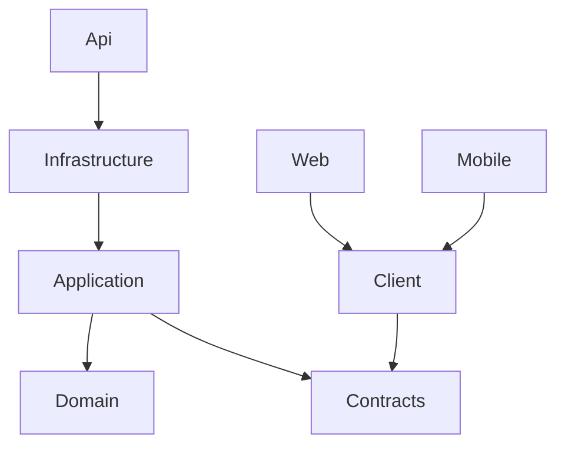

# Décisions d’architecture V1

## Dépendances

Les entités Identity restent dans Infrastructure, pas dans les contrats ni Domain. Les sessions sont les seules entités de domaine persistantes de cette V1 ; aucune table de cartes, groupe ou deck n’est créée. `IAccountService` regroupe les cas d’utilisation de compte sans couche de repository générique ni médiateur artificiel. L’infrastructure implémente cette abstraction avec Identity et EF Core. Des modules métier pourront enrichir Domain/Application plus tard.

## Identité et schéma

`AppUser : IdentityUser<Guid>` possède `CreatedAt`, `UpdatedAt`, `LastLoginAt` et `IsActive`, en UTC. Identity gère le password hash, le security stamp et le lockout. Username est le seul nom public. Les emails et usernames sont normalisés par Identity ; les index uniques de PostgreSQL protègent également des courses entre requêtes. Le rôle `User` est créé par le migrateur, puis attribué transactionnellement à l’inscription. Les rôles futurs seront gérés par les mécanismes standards d’autorisation.

`UserSession` a un UUID, une date d’expiration absolue et une date de révocation. Les refresh tokens ont des UUID, un SHA-256 unique (64 caractères hexadécimaux) et une date d’utilisation. Le secret aléatoire de 512 bits n’est jamais conservé en clair dans la base. Les dates sont en `timestamp with time zone`.

## Cycle de session

- JWT signé HMAC-SHA256 : issuer, audience, expiration, `sub`, `sid`, `jti` et rôle ; durée par défaut 10 minutes, tolérance d’horloge 15 secondes.
- Session absolue 30 jours, bornée à 90 par configuration, non prolongée par les rotations.
- À chaque requête protégée, validation cryptographique **et** contrôle de session et d’activation utilisateur dans PostgreSQL : logout et désactivation prennent effet immédiatement même pour un JWT non expiré.
- Rotation : transaction et `SELECT … FOR UPDATE` sur la session, puis vérification du token. Le token est marqué utilisé et remplacé atomiquement. Deux appels concurrents ne peuvent pas réussir tous les deux.
- Un refresh token déjà utilisé révoque toute la session. Le client sérialise les opérations dans une instance ; plusieurs onglets ne partagent pas ce verrou. Deux onglets qui rafraîchissent simultanément peuvent provoquer une reconnexion : priorité à la détection du rejeu en V1.
- Logout : révocation serveur, suppression du cookie ou de SecureStorage et de l’access token en mémoire. Une panne réseau ne doit pas être annoncée comme une révocation réussie.
- Les anciennes sessions/tokens sont conservés afin de détecter les rejeux jusqu’à expiration. Prévoir une maintenance périodique après la période de rétention : supprimer les sessions expirées (cascade tokens), jamais un token utilisé d’une session encore valide.

## Web, mobile et CSRF

Le web ne stocke aucun token dans localStorage/sessionStorage. Access token en mémoire, refresh token en cookie HttpOnly, Secure en production et SameSite Strict, chemin `/api/auth`. Le mode HTTP Development est l’unique exception au flag Secure. Le cookie est host-only ; la topologie recommandée passe par le même site Caddy pour supprimer les dépendances CORS et cookies tiers. Les domaines site/API doivent être du même site si l’on choisit un accès direct à l’API.

Les POST d’authentification web exigent une origine explicitement autorisée et l’en-tête non simple `X-MyTCG-Client: web` : une page tierce ne peut ni forger l’origine ni passer le préflight CORS. `SameSite=Strict` ajoute une défense. Un appel `mobile` ne lit jamais le cookie et doit apporter le secret dans son JSON ; déclarer ce mode ne permet donc pas de contourner CSRF. Les modifications de compte exigent un Bearer JWT que le navigateur n’envoie pas automatiquement.

MAUI stocke uniquement le refresh token dans SecureStorage, avec le JWT en mémoire. Le serveur utilise la même politique de rotation. Le sélecteur de serveur est disponible hors connexion ; un changement supprime la session avant tout appel au nouvel hôte. Android interdit HTTP en Release, et l’UI refuse les URL non HTTPS en Release. Les sauvegardes Android sont désactivées pour éviter de restaurer un secret chiffré sans sa clé.

## Défenses et limites explicites

Lockout Identity : 5 erreurs, 15 minutes. Limite HTTP : 20 POST d’authentification par minute et IP observée. Derrière Caddy, l’API voit l’IP du proxy : la limite est alors **globale à ce proxy**, volontairement conservatrice en V1. Ne pas activer une confiance générale des en-têtes forwarded : pour une charge réelle, ajouter un limiteur au proxy ou configurer précisément les proxys connus et un stockage distribué. La limite en mémoire n’est pas distribuée entre réplicas.

Connexion : même message pour compte absent, inactif, verrouillé ou mot de passe erroné ; calcul d’un hash dans le chemin compte absent. Les erreurs d’inscription signalent les doublons comme demandé ; cette inscription publique permet donc de déduire une disponibilité de username/email. Pas d’OAuth, de validation d’email ni de récupération de mot de passe dans cette itération. Une modification d’email est immédiate et ne constitue pas une vérification de propriété.

Les logs JSON ne contiennent ni corps de requêtes ni JWT/refresh/password. Le middleware d’erreur journalise seulement le type d’exception et le trace ID ; `EnableSensitiveDataLogging` reste désactivé. Les secrets sont fournis hors Git. HTTPS est terminé par Caddy et les communications interconteneurs passent sur le réseau privé.

## Démarrage et exploitation

Migrations dédiées, puis API, web statique et Caddy. `/health` ouvre réellement une connexion à PostgreSQL. Les processus sont distincts des dépendances retenues dans un snapshot cloud : toujours les redémarrer et vérifier leur santé. MAUI se compile séparément sur les plateformes outillées. Le filtre `MyTCG.Server.slnf` conserve la compilation Linux sans imposer MAUI.
